<a href="https://ariefmaizaki.com">
  
</a>

```http
GET /you HTTP/2
Host: github.com/ninjasaskeh
Accept: text/human
Connection: keep-alive
```

> You are an HTTP request. This README is your round trip: 7 hops from `127.0.0.1` back to `200 OK`.
> The full trip, with a 3D voxel stage and a terminal you can talk to, runs at **[ariefmaizaki.com](https://ariefmaizaki.com)**.

---

### `01` Request &nbsp;·&nbsp; <sub>L0 / CLIENT · 0ms</sub>

```diff
+ $ curl -i https://ariefmaizaki.com/you
  * Resolving ariefmaizaki.com ........................ 12ms
  * Connected to ariefmaizaki.com port 443 ............ 24ms
  * TLS 1.3 handshake ................................. 38ms
  > GET /you HTTP/2 ................................... 41ms
```

### `02` Handshake &nbsp;·&nbsp; <sub>L1 / TLS · 38ms</sub>

```
→ SYN       client: who's on the other end?
← SYN-ACK   Fullstack developer who takes a product from an empty repo to production:
            modelling the data, writing the API, and shipping an interface that feels fast.
→ ACK       client: connection trusted. Show me the certificate.
```

| CERTIFICATE | ● VALID |
| :--- | :--- |
| Subject | `CN=Arief Maizaki` |
| Role | Fullstack Developer |
| Based in | Indonesia (WIB, UTC+7) |
| Focus | Web apps, APIs, databases |
| Status | Open to new projects |

<sub>Issuer: self-signed. Verified by shipped work, see next hop.</sub>

### `03` Routes &nbsp;·&nbsp; <sub>L2 / API · 112ms</sub>

| route | endpoint | response | stack |
| :--- | :--- | :--- | :--- |
| `/01` | [**Hidro Seal ERP**](https://erp-hsti.com/) | Marketing, Inventory and Accounting modules for a manufacturing ERP: RFQ-to-delivery flow, perpetual inventory, general ledger, PDF/Excel reports. | Laravel · React · Inertia.js · PostgreSQL |
| `/02` | [**Hijau Elektronika Indonesia ERP**](https://erp-hei.pronus.co.id/) | Quotation to delivery for a parts manufacturer: BOM-based work orders, six production process modules (injection to assembly), QC handoff. | Laravel · React · Inertia.js · PostgreSQL |
| `/03` | **TJSL WIKA** | CSR reporting for WIKA: unit budgets, spending with admin validation, final-report verification, activity maps, Excel/PDF exports. | Laravel · React · Inertia.js · PostgreSQL |
| `/04` | [**ERP Padang Auto Sejati**](https://pt-padang-auto-sejati.vercel.app/login) | Workshop ERP, API-driven JAMstack on Vercel: vehicle intake, cost estimation, work orders, invoicing. | JAMstack · REST API · Supabase |

### `04` Logs &nbsp;·&nbsp; <sub>L3 / LOGGING · 240ms</sub>

<details open>
<summary><code>2025-01 → now</code> &nbsp; <code>PUT</code> &nbsp; <b>Full-Stack Developer</b> @ PT Program Nusantara Solusindo &nbsp; <code>● 200 OK</code></summary>

```diff
+ Shipped ERP systems for 5+ manufacturers in bonded zones (Kawasan Berikat & Gudang Berikat)
+ Designed 4 core ERP modules: inventory, purchasing, sales, production
+ Built customs compliance reports handling 10,000+ stock movements/month
+ Cut report load time by 40% with PostgreSQL indexing
+ Built SPA pages with React, TypeScript & Inertia.js on Laravel, no separate API layer
```
</details>

<details open>
<summary><code>2024-09 → 2025-01</code> &nbsp; <code>GET</code> &nbsp; <b>Web Developer</b> (internship) @ ITJEN Kemendagri &nbsp; <code>301 Moved</code></summary>

```diff
+ Built an internal mail tracking app (React + Laravel): 15+ reusable components, 20+ REST endpoints
+ Built an internship registration system: 5 modules, 20+ PostgreSQL tables with audit logs
+ Shipped 30+ features and fixed 50+ bugs in a 4-dev team using a Git workflow
```
</details>

### `05` Query &nbsp;·&nbsp; <sub>L4 / DATABASE · 486ms</sub>

```sql
SELECT layer, items FROM skills ORDER BY layer;
```

| layer | items |
| :--- | :--- |
| `Frontend` |      |
| `Backend` |      |
| `Database` |     |
| `Tools` |    |

<sub>(4 rows)</sub>

### `06` Keep-Alive &nbsp;·&nbsp; <sub>L5 / CONNECTION · 820ms</sub>

```
Connection: keep-alive
```

1. It started at President University, where I studied Informatics and found out I like the whole journey of a request, not just one stop along the way.
2. I graduated with a 3.67/4.00 GPA, with the fundamentals in place: data structures, databases, networks, and a lot of late-night debugging.
3. Today I'm at PT Program Nusantara Solusindo, building web applications end to end and shipping them to real users.
4. The connection is still open: always up for the next problem worth solving.

### `07` Response &nbsp;·&nbsp; <sub>200 / OK · 1240ms</sub>

```http
HTTP/2 200 OK
Content-Type: human/collaboration
Location: mailto:maizakiarief@gmail.com
Link: <https://ariefmaizaki.com>; rel="home"
Link: <https://www.linkedin.com/in/arief-maizaki>; rel="linkedin"
X-Reply-Within: 24–48h
X-Local-Time: WIB (UTC+7)
```

Your request made it back. Have a project or a role that fits? Send an email.

[](mailto:maizakiarief@gmail.com)
[](https://ariefmaizaki.com)
[](https://www.linkedin.com/in/arief-maizaki)

<sub>`Via: 1.1 claude-code` · round trip complete in 1240ms (decorative, like on the site).</sub>
